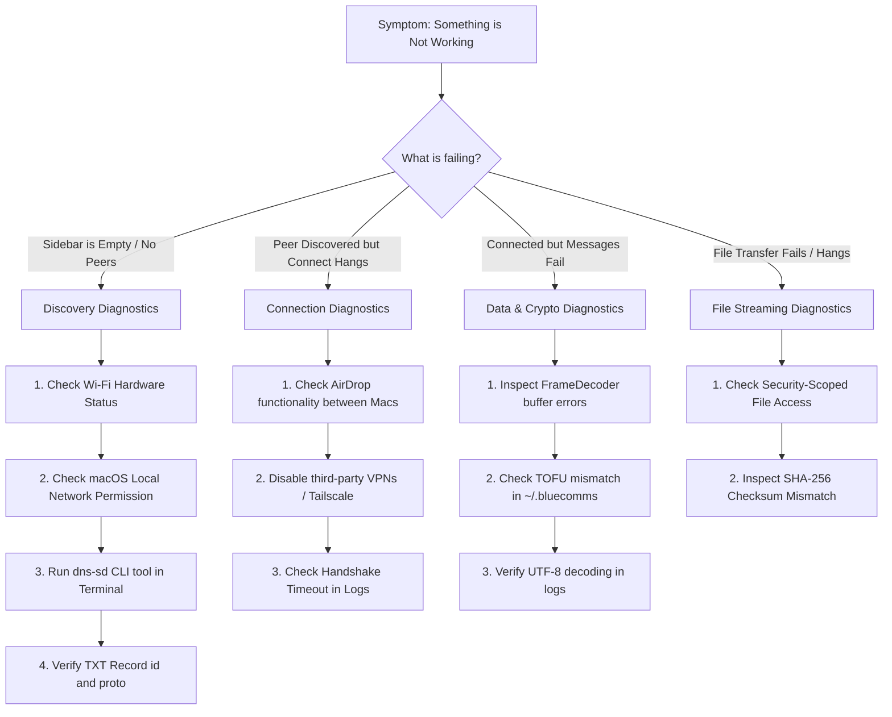

# Developer Debugging & Troubleshooting Guide

> **Document Type:** Practical Engineering Diagnostic & Decision Trees  
> **Repository Path:** [BlueCommsCLI/Sources](../BlueCommsCLI/Sources)  
> **Status:** Grounded in active codebase as of macOS 14+ / Swift 6.1

This guide teaches you how to systematically diagnose, isolate, and fix bugs in BlueComms without guessing or relying on AI.

---

## 1. Troubleshooting Decision Tree



---

## 2. Diagnosing Discovery Issues ("No Peers Appear")

### Step 1: Verify System Tools (`dns-sd`)
Before touching Swift code, use macOS's built-in `dns-sd` utility to test if the Bonjour service is advertising over the local network:

```bash
# Terminal 1: Browse for BlueComms services
dns-sd -B _bluecomms._tcp local.

# Expected Output if working:
# Timestamp     A/R Flags if Domain Service Type Instance Name
# 12:00:00.000  Add     3  1 local. _bluecomms._tcp. MacBook Pro · A1B2C3D4
```

```bash
# Terminal 2: Inspect TXT record of a discovered peer
dns-sd -L "MacBook Pro · A1B2C3D4" _bluecomms._tcp local.

# Expected Output:
# id=6B29FC40-CA47-1067-B31D-00DD010662DA proto=1 name=MacBook Pro
```

#### Diagnostic Rules:
- If `dns-sd -B` shows nothing: The remote device's `NWListener` is not running, or Local Network permission is blocked.
- If `dns-sd -B` finds the name, but `dns-sd -L` has no `id=...`: The TXT record was not attached properly.

---

### Step 2: Check macOS Local Network Permission
1. Open **System Settings** $\rightarrow$ **Privacy & Security** $\rightarrow$ **Local Network**.
2. Verify that **Terminal** (for CLI) or **BlueComms** (for App) is toggled **ON**.
3. If toggled off or missing, delete `~/.bluecomms` and re-run the binary to re-trigger the prompt.

---

### Step 3: Test Hardware Radio (The "AirDrop Test")
Because BlueComms uses the same AWDL radio layer as AirDrop:
1. Open **Finder** $\rightarrow$ **AirDrop** on both Macs.
2. If neither Mac sees the other in AirDrop:
   - Both devices must turn Wi-Fi **ON** (they do not need to be on the same Wi-Fi router).
   - Turn Bluetooth **ON** (AWDL uses BLE beacons for initial out-of-band proximity discovery).
   - Quit **Tailscale**, **WireGuard**, or corporate VPNs that install aggressive packet filters.

---

## 3. Diagnosing Connection Issues ("Stuck on Connecting")

### Step 1: Inspect Logs for Handshake Timeout
In [PeerConnection.swift:L48](../BlueCommsCLI/Sources/BlueCommsCore/PeerConnection.swift#L48), a 10-second timer fires if the remote peer fails to exchange public keys:

```
[CONNECTION] Preparing...
[CONNECTION] Transport ready. Completing handshake...
[CONNECTION] Handshake timed out.
```

#### What this means:
- TCP connection was opened, but the remote device never sent its 49-byte `HandshakePayload`.
- Cause: Remote app hung on main thread or crashed during handshake processing.

---

### Step 2: Test Isolated In-Process Pairing
You can verify the entire discovery, connection, handshake, and file transfer pipeline on a single Mac by running the built-in self-test suite:

```bash
cd BlueCommsCLI
swift run BlueCommsSelfTest
```

If all 32 tests pass, the Swift networking and cryptographic algorithms are 100% correct; any failure between two separate physical Macs is due to OS radio/permission boundaries.

---

## 4. Diagnosing Cryptographic Failures (`TOFU Mismatch`)

If the logs display:
```
[SECURITY] Peer identity key changed. Refusing to connect.
```

### Cause:
The remote Mac was re-imaged, had its `~/.bluecomms/` directory wiped, or generated a new private key while retaining the same `device-id`.

### Resolution:
Inspect `~/.bluecomms/known-peers.json` on the local Mac:
```bash
cat ~/.bluecomms/known-peers.json
```
Delete the stale peer entry or wipe `~/.bluecomms/known-peers.json` to re-trust the peer on first use.
