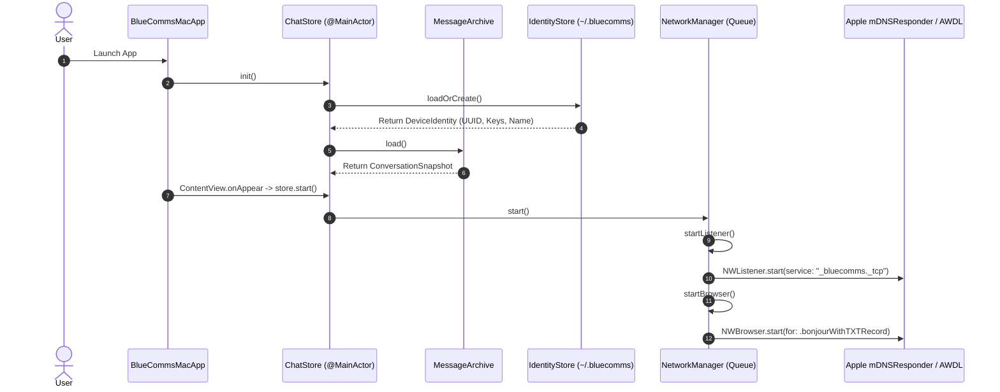
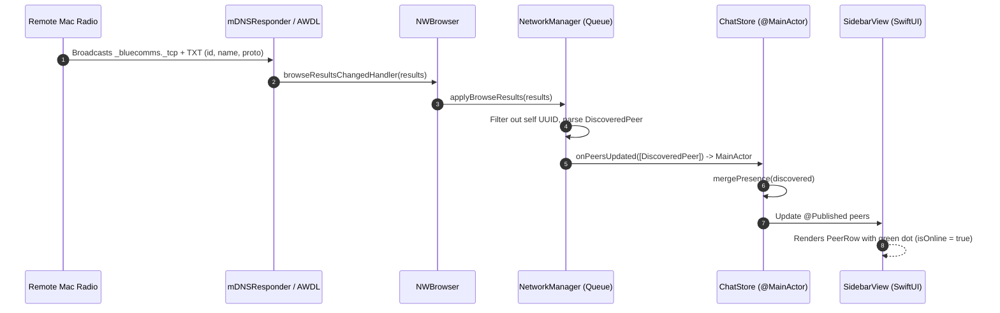
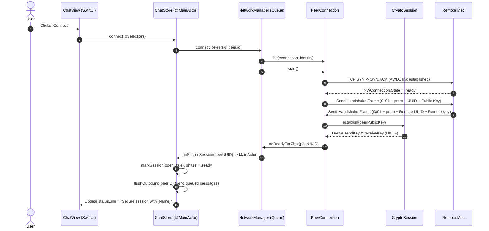
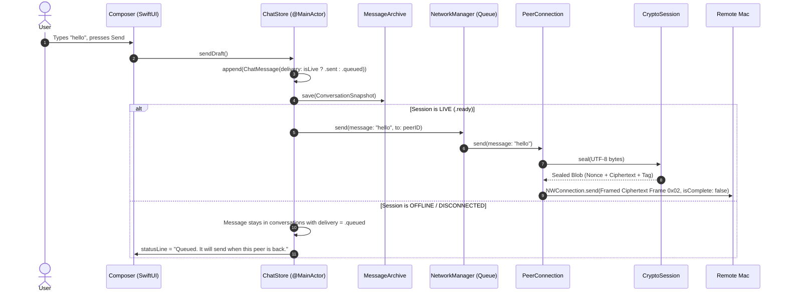
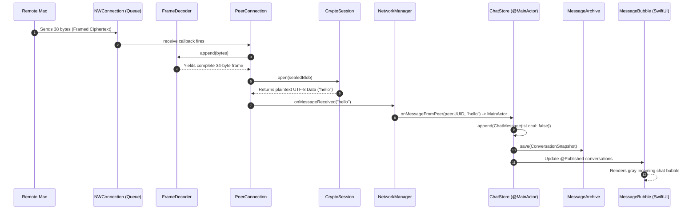
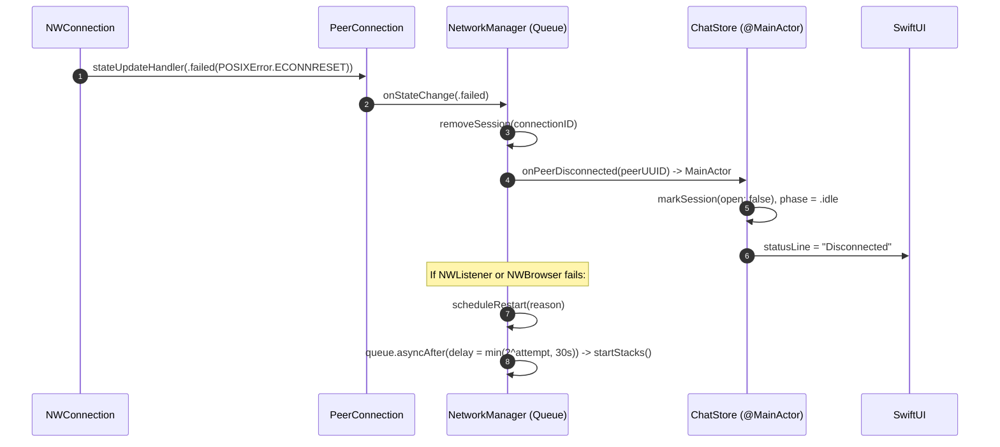
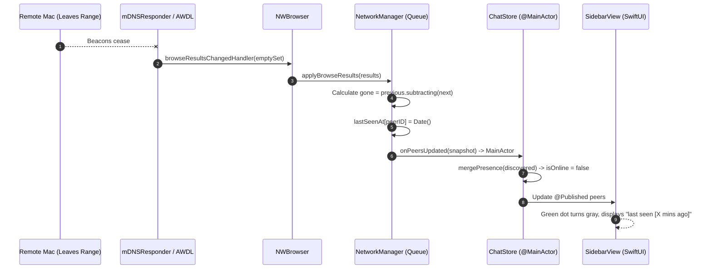
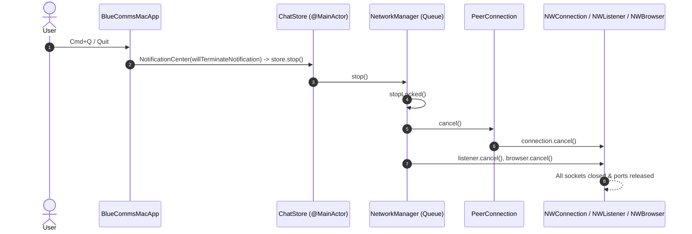

# Runtime Flow & State Transitions

> **Document Type:** Execution Flow Diagrams & Sequence Specifications  
> **Repository Path:** [BlueCommsCLI/Sources](../BlueCommsCLI/Sources)  
> **Status:** Grounded in active codebase as of macOS 14+ / Swift 6.1

---

## 1. Flow A: Application Startup

- **Initiating Component:** `BlueCommsMacApp.init()` and `ContentView.onAppear`.
- **Function Calls:** `IdentityStore.loadOrCreate()`, `MessageArchive.load()`, `NetworkManager.start()`, `startListener()`, `startBrowser()`.
- **State Transition:** `didStart` becomes `true`; `statusLine` changes to `"Starting local radio..."`.
- **UI Update:** SwiftUI window renders with sidebar displaying local device name, short ID, and key fingerprint.

---

## 2. Flow B: Device Discovery

- **Initiating Component:** Remote peer's `NWListener` beacon over AWDL/Wi-Fi.
- **Function Calls:** `NWBrowser.browseResultsChangedHandler`, `NetworkManager.applyBrowseResults()`, `ChatStore.mergePresence()`.
- **State Transition:** Peer added to `ChatStore.peers` with `isOnline: true`.
- **UI Update:** Peer appears in sidebar with green online dot.

---

## 3. Flow C: Device Connection & Cryptographic Handshake

- **Initiating Component:** User clicking "Connect" in `ChatView`.
- **Function Calls:** `ChatStore.connectToSelection()`, `NetworkManager.connect(to:)`, `PeerConnection.sendHandshake()`, `CryptoSession.establish()`, `ChatStore.flushOutbound()`.
- **State Transition:** `ChatStore.phase` $\rightarrow$ `.connecting` $\rightarrow$ `.ready`; `isSessionOpen` $\rightarrow$ `true`.
- **UI Update:** "Connect" button changes to "Disconnect", sidebar displays blue **LIVE** badge.

---

## 4. Flow D: Sending a Message (Text & Queued)

---

## 5. Flow E: Receiving a Message

---

## 6. Flow F: Connection Failure & Backoff Recovery

---

## 7. Flow G: Device Disappearing (Walk Away)

---

## 8. Flow H: App Termination

---

## 9. Flow I: Multiple Simultaneous Devices

- `NetworkManager` maintains a dictionary `sessions: [String: PeerConnection]` keyed by peer device UUID.
- If Mac A connects to Mac B and Mac C simultaneously:
  - Both connections operate on independent `NWConnection` sockets.
  - Encryption sessions maintain separate symmetric keys and sequence counters.
  - `ChatStore.conversations` maintains independent message threads per peer UUID.

---

## 10. Flow J: Reconnection & Queue Delivery

When a disconnected peer reappears and reconnects:
1. `ChatStore` executes Flow C (Handshake).
2. When `onSecureSession` triggers, `ChatStore.flushOutbound(for: peerID)` scans `conversations[peerID]`.
3. Any `ChatMessage` with `delivery == .queued` is automatically encrypted and sent via `manager.send()`.
4. Its delivery state is updated to `.sent`, saved to disk, and rendered with the updated caption.
